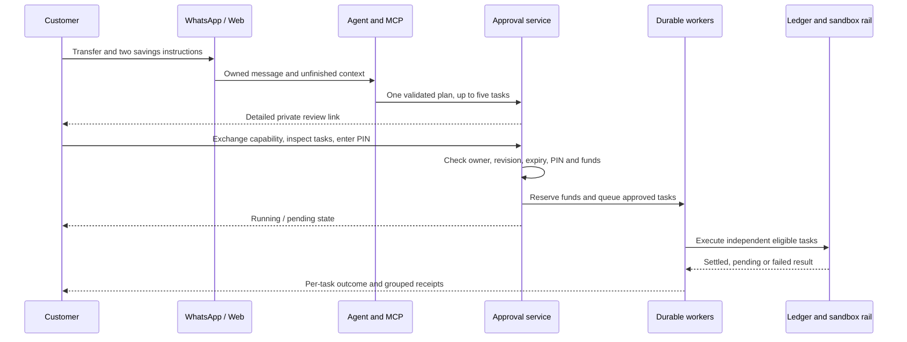

# Architecture and execution model

## Boundaries

I separate language understanding from financial authority. The model reasons over a conversation and uses owner-scoped MCP tools. The application validates the proposal, presents a private review and checks the transaction PIN. Durable workers execute only approved tasks.

The MCP server and client communicate through the SDK’s in-memory transport inside the Node process. This is actual tool discovery and invocation, not a public remote MCP endpoint. External ChatGPT/Claude clients and their OAuth lifecycle are outside this build.

| Responsibility | Source |
| --- | --- |
| HTTP, sessions, webhook verification, private exports | `src/server.ts`, `src/security.ts` |
| Context, clarification, grounded bank candidates | `src/ai/agent.ts`, `src/ai/bank-grounding.ts` |
| MCP schemas, ownership and tool dispatch | `src/ai/mcp.ts` |
| Model, media and inference recovery | `src/ai/model.ts`, `src/ai/media.ts`, provider adapters |
| Plan preparation, approval and settlement | `src/core.ts`, `src/contracts.ts` |
| Journal postings and available funds | `src/ledger.ts`, `src/db.ts` |
| Inbox, task and notification jobs | `src/worker.ts`, `src/whatsapp-delivery.ts` |
| Ajo terms, calendar allocation and fees | `src/ajo-terms.ts`, `src/ajo-allocation.ts` |
| Recurring savings | `src/savings-schedules.ts` |
| Receipts and statements | `src/receipt-image.ts`, `src/receipts.ts`, `src/statements.ts` |

## A compound request

The model must retain amount, account, bank and other supplied details across follow-up questions. A correction replaces the specified field; it does not discard the rest of the batch. A completed or cancelled plan is not reused as a new payment.

A valid ten-digit account remains a candidate even when it resembles a phone number. The customer must supply the bank or select an owned saved recipient. The model cannot infer an account’s bank from its digits. Current sandbox resolution does not establish a real bank identity.

## MCP capabilities

Read tools inspect balances, test funding details, beneficiaries, goals, service catalogues, activity, Ajo books, schedules, private plan status and notification status. Product-help and affordability tools return bounded information and arithmetic rather than invented prices or balances.

Preparation tools create or revise a single plan. Other narrowly scoped tools manage non-payment operations such as language, saved beneficiaries, invitation controls and cancellation. Organizer tools require organizer access. Membership tools propose private acceptance; they cannot consent for the member.

There is no model-facing payment-execution or PIN-verification tool. The model never receives the private approval capability from tool output. Models, extracted text and tool fields remain untrusted inputs; deterministic schemas and service checks enforce the boundary.

## Approval and state

Private plans and initial capability links expire after five minutes. The opaque capability contains random bytes; its SHA-256 hash, owner, purpose, target, revision, expiry and used state are stored in the database. Exchange is single-use and issues a 30-minute, purpose-scoped HttpOnly session cookie. Financial review expiry is still checked at approval even when the browser session remains valid.

Editing increments the revision and invalidates the earlier review. Approval verifies the exact task digest, revision, expiry, PIN and available funds before queueing. Duplicate approval of the same accepted revision returns its existing outcome instead of submitting another payment.

A plan can be ready, running, pending or terminal. Terminal outcomes distinguish success, partial completion, failure, cancellation and expiry. Individual tasks have their own status; a failed task does not erase a settled task’s receipt.

Independent read-only MCP calls overlap. MCP mutations retain their order. Approved task workers execute eligible independent tasks with bounded concurrency; dependency edges preserve order for operations sharing a newly created goal, Ajo member or other required state. Parallelism is not permission to race shared balances.

## Ledger and recovery

All amounts are integer kobo. Journals are balanced and append-only; balances derive from postings. Holds reserve the batch’s required funds before work runs. PostgreSQL transactions, locking and journal protections prevent concurrent approvals from creating an unbalanced debit.

A timeout is not proof that a payment failed. Uncertain provider outcomes retain their reservation and reconcile the existing reference. They do not generate a fresh transfer. Jobs carry leases so interrupted work can be reclaimed. Inference retries never wrap payment execution.

Notifications run separately from settlement. WhatsApp submission acceptance, sent, delivered, read and failed statuses are separate facts. An ambiguous send acknowledgement is not automatically resent, and a notification failure cannot change a successful payment into a PIN error. Private receipts remain available independently.

The only financial adapter shipped here is `SandboxRail`. Its bank and bill catalogues, recipient resolution, references and balances are test behavior. Replacing it with a real provider requires provider-specific commercial, compliance, settlement and reconciliation work.

## Notebook and Ajo records

Vision returns candidates, not ledger authority. The organizer matches extracted rows to members and reviews the proposed records. Receipt screenshots cannot credit an account. An unreviewed notebook import does not silently create funded contributions.

Collected cash records an organizer liability. A bank-funded replacement can settle that liability; recording the same cash cannot also mint a wallet balance. Contribution allocation covers the oldest unpaid dates, completes partial days and can cover future dates only within the agreed cycle. Replacing cash does not count the same days twice.

Members privately accept the disclosed contribution and fee terms. Invitations expire and can be rotated or revoked without cancelling existing memberships. A cycle fee is explicitly none, one daily contribution or a fixed amount, charged once from the first payout; reviews and receipts distinguish principal, fee and net. Concurrent changes require fresh review.

Older records without dated evidence must be reconciled before new dated allocation. The system does not rewrite their funded balances to manufacture historical dates.

## Language and media

The supported conversation languages are English, Pidgin, Yoruba, Igbo and Hausa. Current clear speech takes precedence over a saved language; ambiguous fragments retain the prior language. The Gemini adapter validates language metadata separately from financial tool arguments. Other adapters use the language tool and shared agent policy; verify the selected provider’s actual behavior before recording a demo.

Speech recognition and image understanding are separate from reasoning. No recognizer can approve a task. Automatic transcription is preferred over a backup’s previous-language hint. Low-confidence or unreadable input needs clarification rather than guessed account digits. Native-speaker evaluation and broader accent coverage remain quality work, not guarantees established by tool-schema tests.
